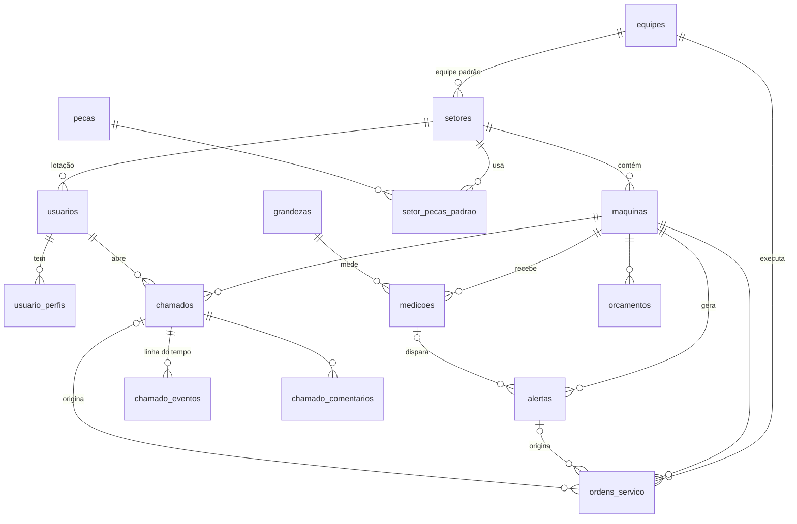

# Banco de dados · PredictMaint

MySQL 8. Banco: **`predictmaint`**.

| Arquivo | O que faz |
| --- | --- |
| `init/01-schema.sql` | Cria o banco, as tabelas e as views (apaga e recria tudo). |
| `init/02-seed.sql` | Dados de exemplo — os mesmos do modo demonstração do front. |

## Como rodar

**Docker:** os dois arquivos rodam sozinhos na primeira subida do container.
Para recriar do zero:

```bash
docker compose down -v
docker compose up -d database
```

**XAMPP / MySQL Workbench:** execute `01-schema.sql` e depois `02-seed.sql`.
No `backend/.env`, use `DB_NAME=predictmaint`.

## Acesso ao banco (desenvolvimento)

| Usuário | Senha | Uso |
| --- | --- | --- |
| `root` | `senai@123` | Administração (DBeaver, Workbench) |
| `app_user` | `senai@123` | Usado pela API |

Host `localhost`, porta `3306`, banco `predictmaint`. No DBeaver, em *Propriedades do driver*,
use `allowPublicKeyRetrieval=true` e `useSSL=false`.

> Senha padronizada só para o ambiente de desenvolvimento da equipe. Na publicação (Coolify),
> configure uma senha forte nas variáveis de ambiente.

## Logins de teste

| E-mail | Matrícula | Senha | Perfis |
| --- | --- | --- | --- |
| admin@mantech.com.br | adm001 | senai@123 | gestor, técnico, funcionário |
| funcionario@mantech.com.br | fun001 | senai@123 | funcionário (Estamparia) |
| tecnico@mantech.com.br | tec001 | senai@123 | técnico |

As senhas estão salvas com **bcrypt** (`senha_hash`). No login, o backend compara com
`bcrypt.compare(senhaDigitada, usuario.senha_hash)` — nunca grave senha em texto puro.

## Diagrama (DER)



## Tabelas

| Tabela | Tela que usa | Observação |
| --- | --- | --- |
| `maquinas` | Máquinas, Planta, Dashboard | `codigo` (PH-03) é o "id" que o front mostra. Status sai da `saude`. |
| `setores`, `equipes` | Filtros, OS, Orçamento | Setor guarda os parâmetros padrão do orçamento. |
| `usuarios`, `usuario_perfis` | Login | Um usuário pode ter vários perfis. |
| `grandezas` | Medições, Alertas › Limites | Vibração, temperatura, corrente e seus limites. |
| `medicoes` | Medições, gráficos | 11 pontos por máquina e grandeza no seed. |
| `alertas` | Alertas, Dashboard | `estado`: novo, reconhecido, resolvido. |
| `ordens_servico` | Ordens (Kanban) | Código exibido: `OS-` + id com 4 dígitos. |
| `chamados`, `chamado_eventos`, `chamado_comentarios` | Abrir chamado, Meus chamados | Código exibido: `CH-` + id. |
| `pecas`, `setor_pecas_padrao`, `orcamentos` | Orçamento | `detalhes` guarda os parâmetros do cálculo em JSON. |

## Views (atalho para o backend)

As views já devolvem os campos com os nomes que o front espera:

- `vw_maquinas` — `id` (código), `setor`, `status` calculado, `custoParada`, `tend`, `prox`
- `vw_medicoes` — com `nome`, `unidade` e `situacao` (normal/atencao/critico)
- `vw_alertas` — com `ativo`, `setor` e `min` (minutos desde o alerta)
- `vw_ordens` — `id` no formato `OS-0241` e `vencida`
- `vw_chamados` — `id` no formato `CH-1042`

Exemplo no controller: `SELECT * FROM vw_maquinas WHERE setor = ? ORDER BY saude`.

## Regras importantes

- **Excluir máquina:** máquinas com chamados, OS ou orçamentos não podem ser apagadas
  (a chave estrangeira bloqueia). Use `UPDATE maquinas SET ativo = FALSE` — elas somem
  da `vw_maquinas` e o histórico fica preservado.
- `saude` só aceita 0 a 100 e `limite_atencao` precisa ser menor que `limite_critico`.
- As datas do seed são relativas ao dia em que ele roda, então a demo nunca fica vencida.
